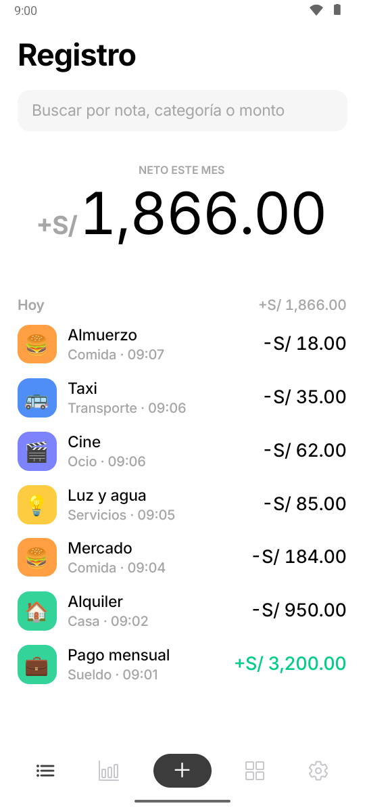
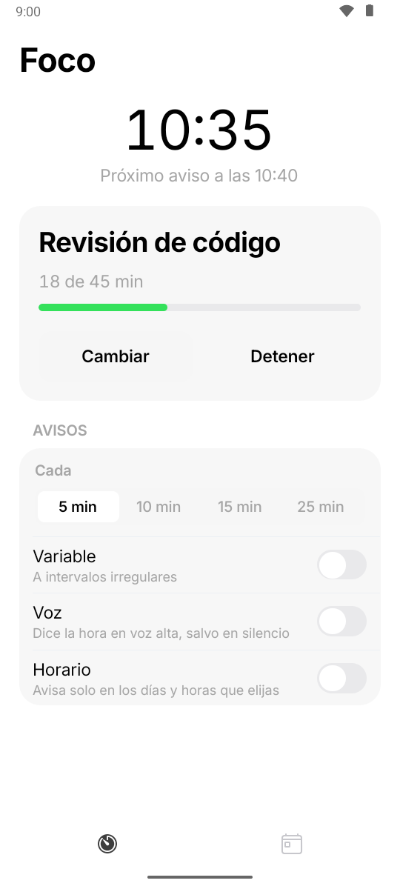

# pocket

[](https://github.com/risinghq/pocket/actions/workflows/ci.yml)

pocket holds small apps for iOS and Android that share one set of components and
one on-device store. Their interfaces are in Spanish.

<p align="center">
  <picture>
    <source media="(prefers-color-scheme: dark)" srcset="apps/atomic/docs/screenshots/registro-dark.png">
    
  </picture>
  <picture>
    <source media="(prefers-color-scheme: dark)" srcset="apps/foco/docs/screenshots/ahora-dark.png">
    
  </picture>
</p>

## Apps

| App                             | What it does                                                                                   |
| ------------------------------- | ---------------------------------------------------------------------------------------------- |
| [atomic](apps/atomic/README.md) | A plain expense tracker: expenses and income in a few taps, where the money went, and budgets. |
| [foco](apps/foco/README.md)     | Tells the time every few minutes, so you notice where your attention went and choose again.    |

Each app's README lists its features. The apps share their components through
`@rising/ui`, shown in the `apps/catalog` gallery, and their data model and
store through `@rising/core`. See [Repository layout](docs/architecture.md).

## Get started

```bash
git clone https://github.com/risinghq/pocket
cd pocket
mise install
bun install
bun run --cwd apps/atomic start
```

`mise install` installs the tool versions in `mise.toml`. `start` runs the
development server for one app; replace `atomic` with any app above. Scan its QR
code with Expo Go. Simulators, emulators and preview builds are in
[Running the apps](docs/running.md).

## Documentation

The [manual](docs/README.md) covers running the apps, the repository layout,
testing, the shared packages, and each app's architecture.

## Contributing

See [CONTRIBUTING.md](.github/CONTRIBUTING.md).

## License

[Apache License 2.0](LICENSE).
