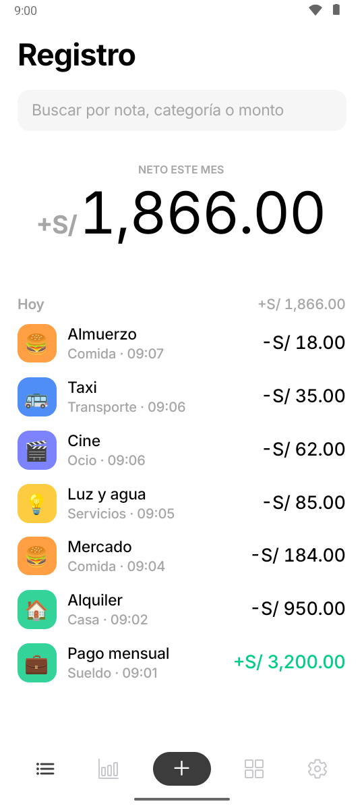
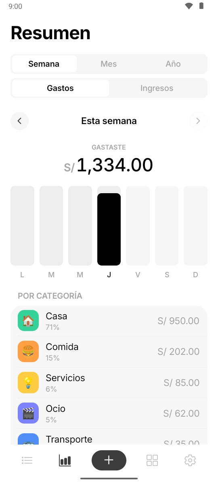
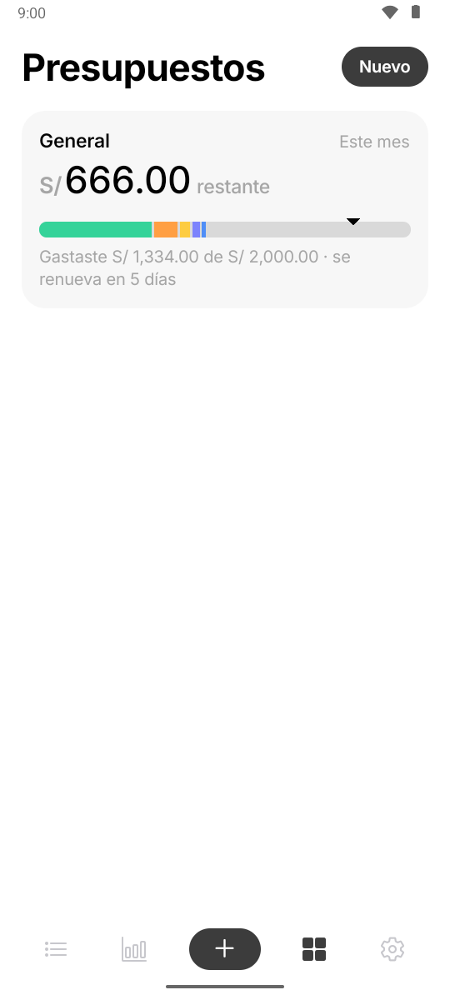

# atomic

atomic is a plain expense tracker for iOS and Android. It records expenses and
income in a few taps, shows where the money went, and keeps weekly or monthly
budgets. Its interface is in Spanish.

<p align="center">
  <picture>
    <source media="(prefers-color-scheme: dark)" srcset="docs/screenshots/registro-dark.png">
    
  </picture>
  <picture>
    <source media="(prefers-color-scheme: dark)" srcset="docs/screenshots/resumen-dark.png">
    
  </picture>
  <picture>
    <source media="(prefers-color-scheme: dark)" srcset="docs/screenshots/presupuestos-dark.png">
    
  </picture>
</p>

## Run it

From the repository root, after the install in the
[root README](../../README.md#get-started):

```bash
bun run --cwd apps/atomic start
```

Scan the QR code with Expo Go. The app opens on one screen that asks for the
currency and the first day of the week. **Empezar** lands on Registro.

## Features

- **Fast entry.** The add button opens a number pad. Confirm the amount, add a
  note if you want, and tap a category to save. Entries recorded at least twice
  in the last 90 days appear above the pad and save in one tap.
- **Registro.** Every transaction grouped by day, with this month's net on top.
  Tap one to edit it, long press to delete it. The search field narrows the list
  by note, category or amount.
- **Resumen.** Spending or income for a week, a month or a year: a bar chart and
  the share of each category.
- **Presupuestos.** An overall budget split by category, and budgets per
  category, each per week or per month, with what is left per day.
- **Recurring entries.** Repetir saves an entry that repeats every week, month
  or year. Ajustes lists the rules and stops one.
- **Widget.** On Android, a home-screen widget shows what was spent and what is
  left per day, with a button that opens the number pad.
- **Ajustes.** The currency (soles, dollars or euros), the first day of the
  week, your own categories, a CSV export of every transaction, and erasing all
  data.
- **Local storage.** Data lives in SQLite on the device. An optional account,
  through Google, GitHub or email, syncs it across devices.
- **Exact money arithmetic.** Amounts are stored and summed in integer cents.

## Documentation

- [Architecture](docs/architecture.md): the code map, the tabs and the
  boundaries between them.
- [Data flow](docs/data-flow.md): how the app starts, and how an entry travels
  from the number pad to the store and every screen.
- [The pocket manual](../../docs/README.md): running, testing and the shared
  packages.
