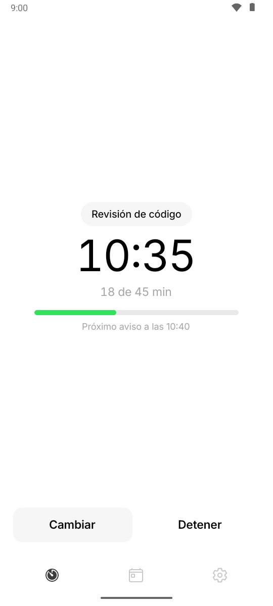
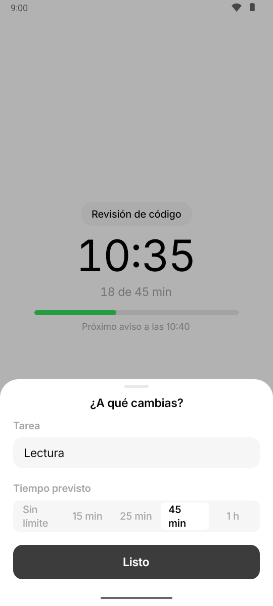
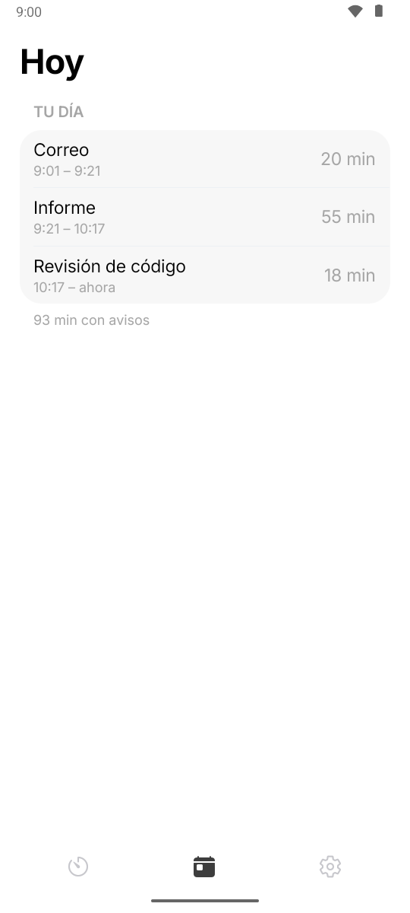

# foco

foco tells the time every few minutes, so you notice where your attention went
and choose again. You say what you are doing and how long it should take; each
chime says how long you have been at it. It runs on iOS and Android, and its
interface is in Spanish.

<p align="center">
  <picture>
    <source media="(prefers-color-scheme: dark)" srcset="docs/screenshots/ahora-dark.png">
    
  </picture>
  <picture>
    <source media="(prefers-color-scheme: dark)" srcset="docs/screenshots/tarea-dark.png">
    
  </picture>
  <picture>
    <source media="(prefers-color-scheme: dark)" srcset="docs/screenshots/hoy-dark.png">
    
  </picture>
</p>

## Run it

From the repository root, after the install in the
[root README](../../README.md#get-started):

```bash
bun run --cwd apps/foco start
```

Scan the QR code with Expo Go, pick how often to chime, then tap **Empezar**.
Expo Go lacks the voice module, so Voz appears only in a native Android build:
`bun run --cwd apps/foco android`.

## Features

- **Chimes.** A notification every 5, 10, 15 or 25 minutes, on the clock (:00,
  :05, :10), with the time and the minutes spent on the current task. They
  arrive with the app closed.
- **Unnamed tasks.** Start without naming the task; Ahora shows only the clock
  and the minutes.
- **Timebox.** Give a task a time, and once it has run over, chimes say by how
  much, with a longer vibration.
- **Cambié.** Answer a chime with Cambié to name the new task, or Sigo to carry
  on.
- **Variable.** Chimes at irregular intervals, up to 40% shorter or longer, so
  you stop waiting for them.
- **Voz.** On Android, each chime also says the time aloud as people say it
  ("ocho y cuarto") with the minutes spent, except in silent or vibrate mode.
- **Horario.** Chimes only on the days and hours you choose.
- **Hoy.** Today's tasks in order, and the minutes each took.
- **Local only.** The settings and the day's log live in SQLite on the device,
  with no account.

## Documentation

- [Architecture](docs/architecture.md): the code map and how chimes are
  scheduled.
- [The pocket manual](../../docs/README.md): running, testing and the shared
  packages.
